<a href="https://gallowforge.github.io/Ethereal/#gh-dark-mode-only"><picture><source media="(max-width: 767px)" srcset="docs/readme/hero-dark-phone.webp 2.835x"><source srcset="docs/readme/hero-dark.webp 2x"></picture></a><a href="https://gallowforge.github.io/Ethereal/#gh-light-mode-only"><picture><source media="(max-width: 767px)" srcset="docs/readme/hero-light-phone.webp 2.835x"><source srcset="docs/readme/hero-light.webp 2x">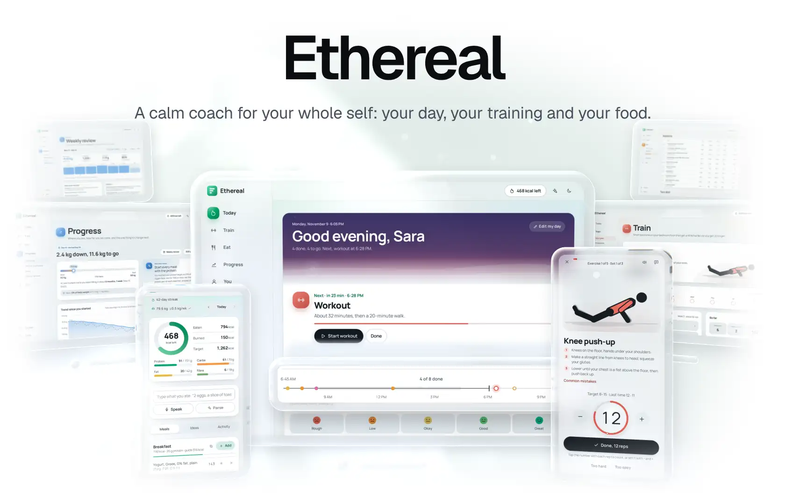</picture></a>

Most health apps do one thing, charge a subscription for it, and leave you to work out the rest: which workout, what to eat, when, and whether any of it is working. **Ethereal is a calm coach for your whole self.** It plans your day around your life, trains you at home with animated demos that grow with you, keeps your food on track, and shows the trend that matters. It runs in the browser on any phone, tablet or computer, works offline, needs no account, and every formula is open.

**[Open the app](https://gallowforge.github.io/Ethereal/)** &nbsp;·&nbsp; [Quickstart](#quickstart) &nbsp;·&nbsp; [How it works](#how-it-works) &nbsp;·&nbsp; [Compare](https://gallowforge.github.io/Ethereal/compare/) &nbsp;·&nbsp; [What's new](https://gallowforge.github.io/Ethereal/changelog/) &nbsp;·&nbsp; [Releases](https://github.com/gallowforge/Ethereal/releases)

<a href="https://github.com/gallowforge/Ethereal/actions/workflows/ci.yml#gh-dark-mode-only"><picture><source media="(max-width: 767px)" srcset="docs/readme/numbers-dark-phone.webp 2.835x"><source srcset="docs/readme/numbers-dark.webp 2x">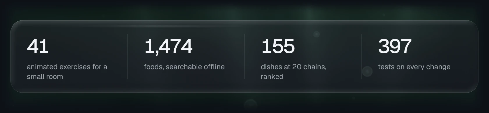</picture></a><a href="https://github.com/gallowforge/Ethereal/actions/workflows/ci.yml#gh-light-mode-only"><picture><source media="(max-width: 767px)" srcset="docs/readme/numbers-light-phone.webp 2.835x"><source srcset="docs/readme/numbers-light.webp 2x">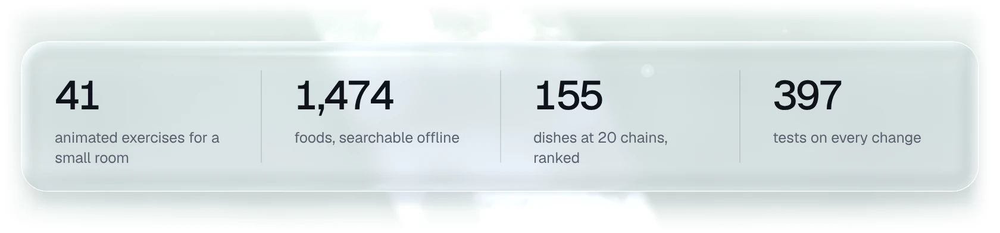</picture></a>

<br>

<a href="https://gallowforge.github.io/Ethereal/today/#gh-dark-mode-only"><picture><source media="(max-width: 767px)" srcset="docs/readme/today-dark-phone.webp 2.835x"><source srcset="docs/readme/today-dark.webp 2x">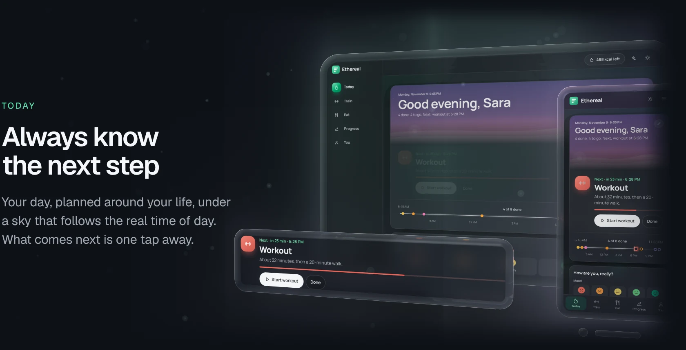</picture></a><a href="https://gallowforge.github.io/Ethereal/today/#gh-light-mode-only"><picture><source media="(max-width: 767px)" srcset="docs/readme/today-light-phone.webp 2.835x"><source srcset="docs/readme/today-light.webp 2x">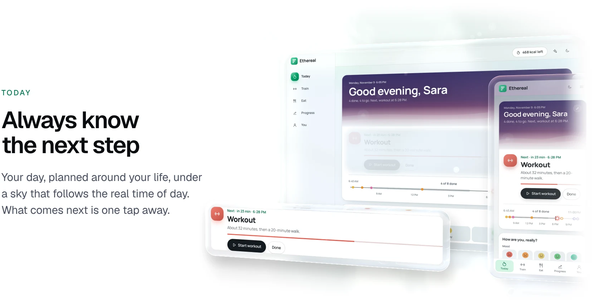</picture></a>

- **A living sky.** Today opens under a sky that follows your real time of day and your city's sun, from a lavender first light to a deep indigo night with the moon in tonight's phase. Tell it once when you wake, eat and work, and it does the planning.
- **A Now card and a day track.** The Now card counts down to what is next: log lunch, start the workout, weigh in, or tick it done. Under it, your waking day is one fine line, filled up to now, with every moment as a dot in its own colour. Swipe a row to tick it off.
- **Your whole day in one line.** Meals, medicines at the right time, training placed clear of work and meals, winding down and sleep.
- **No guilt.** Missed something? Catch me up gathers it: tick what you did, let the rest go.
- **Optional:** prayer times calculated on the device, and fasting schedules that move meals and training, for those who want them.

<a href="https://gallowforge.github.io/Ethereal/train/#gh-dark-mode-only"><picture><source media="(max-width: 767px)" srcset="docs/readme/train-dark-phone.webp 2.835x"><source srcset="docs/readme/train-dark.webp 2x">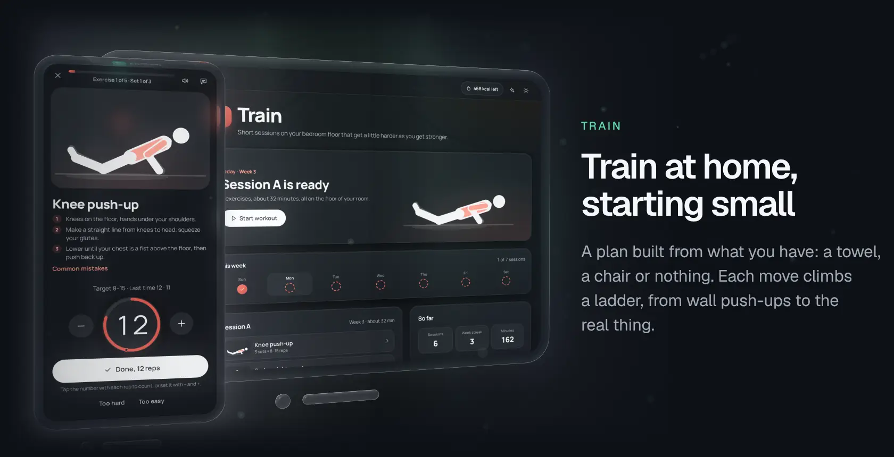</picture></a><a href="https://gallowforge.github.io/Ethereal/train/#gh-light-mode-only"><picture><source media="(max-width: 767px)" srcset="docs/readme/train-light-phone.webp 2.835x"><source srcset="docs/readme/train-light.webp 2x">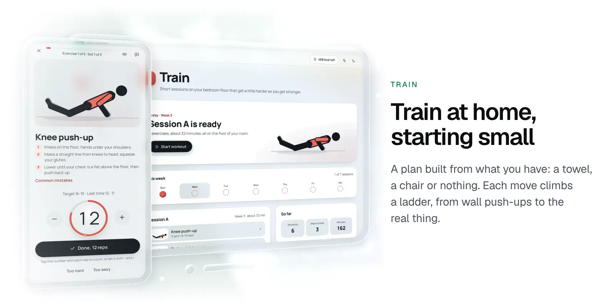</picture></a>

- **Built from your room.** A towel, a chair, a bed, or nothing; the days that suit you and where you are starting. Week one is deliberately light, and each move climbs a ladder, from wall push-ups to the real thing.
- **A guided player.** Animated demo, a rep counter you tap with each rep, a 3-2-1 count-in for timed holds, a rest timer with beeps and optional spoken cues, and the screen kept awake. Beat last time's number and it says so. Close it mid-set and it resumes from the same place.
- **It moves you up when you are ready.** Hit the top of the range on every set and the next session offers the harder move. Too hard today? Swap down in one tap.
- **41 exercises with animated demos,** the muscles they work, form cues and the mistakes to avoid. Knees complaining? One switch removes jumping, lunging and deep single-leg work.

<a href="https://gallowforge.github.io/Ethereal/today/#gh-dark-mode-only"><picture><source media="(max-width: 767px)" srcset="docs/readme/diary-dark-phone.webp 2.835x"><source srcset="docs/readme/diary-dark.webp 2x">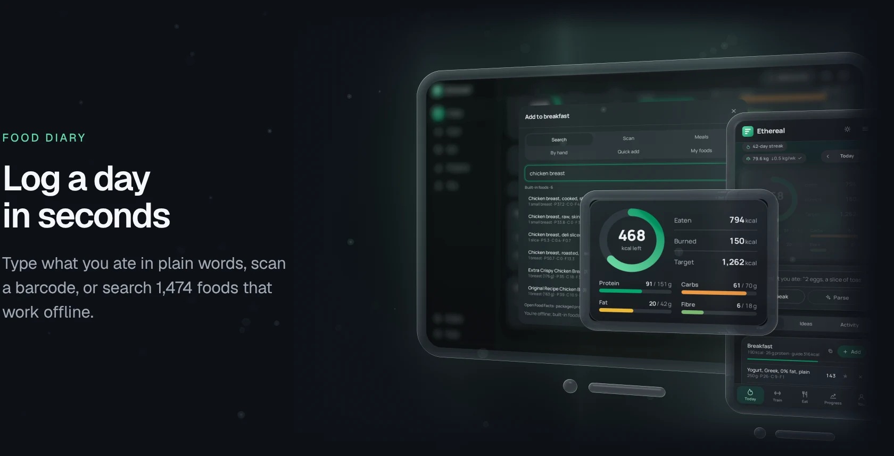</picture></a><a href="https://gallowforge.github.io/Ethereal/today/#gh-light-mode-only"><picture><source media="(max-width: 767px)" srcset="docs/readme/diary-light-phone.webp 2.835x"><source srcset="docs/readme/diary-light.webp 2x">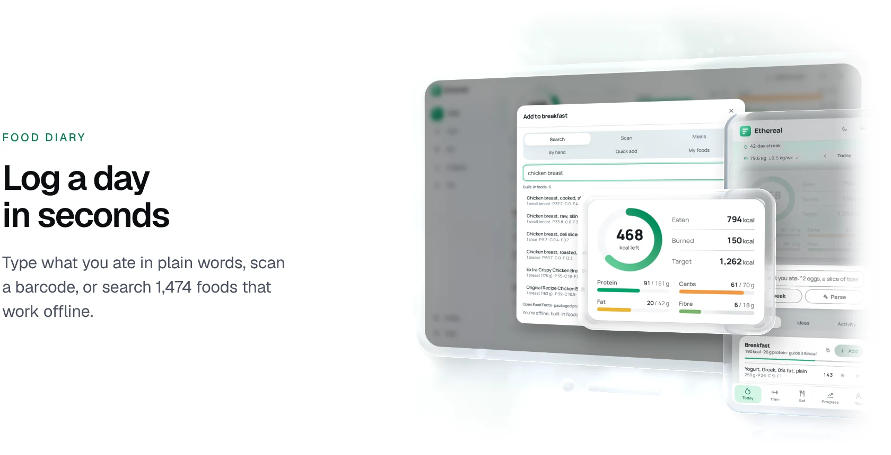</picture></a>

- **Plain-language entry.** "2 eggs, a slice of toast and 150g greek yogurt" becomes three logged foods in one tap.
- **Barcodes.** Packaged products come from Open Food Facts, with Nutri-Score and NOVA grades.
- **Shortcuts that add up.** Your usual for each meal at your usual amount, saved meals, favourites, copy yesterday, and a suggestion for what fits next. Removed something by mistake? Undo.
- **What is left, at a glance.** The ring shows what is left of the day, and the bars track protein, carbs, fat and fibre against your targets.

<a href="https://gallowforge.github.io/Ethereal/progress/#gh-dark-mode-only"><picture><source media="(max-width: 767px)" srcset="docs/readme/progress-dark-phone.webp 2.835x"><source srcset="docs/readme/progress-dark.webp 2x">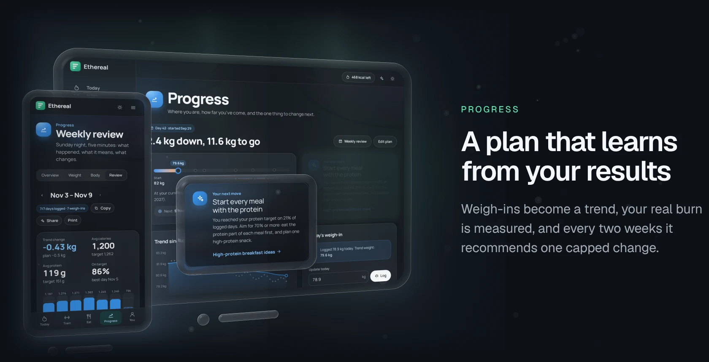</picture></a><a href="https://gallowforge.github.io/Ethereal/progress/#gh-light-mode-only"><picture><source media="(max-width: 767px)" srcset="docs/readme/progress-light-phone.webp 2.835x"><source srcset="docs/readme/progress-light.webp 2x">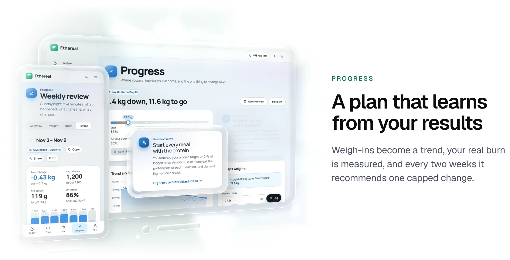</picture></a>

- **A target you can trust.** A few questions give you a calorie target, protein, macros and a realistic goal date. Deficits are capped and floored, so the app never suggests anything reckless.
- **It learns your real burn.** After a few weeks it measures your actual expenditure from what you ate and how your trend moved.
- **Every two weeks, one decision.** It compares your real rate with the plan and recommends one specific, capped calorie change. Progress opens on where you are and the single change most worth making, or tells you to change nothing.
- **The trend, not the noise.** Daily weigh-ins are smoothed, so water weight and one salty dinner never look like failure; drag the scale to log one, and a new low in the trend gets a small celebration. Your rhythm shows twelve weeks of showing up, and on Sunday night the weekly review takes five minutes: the week in numbers, what it means, and next week's change applied in one tap.

<a href="https://gallowforge.github.io/Ethereal/eating-out/#gh-dark-mode-only"><picture><source media="(max-width: 767px)" srcset="docs/readme/food-dark-phone.webp 2.835x"><source srcset="docs/readme/food-dark.webp 2x">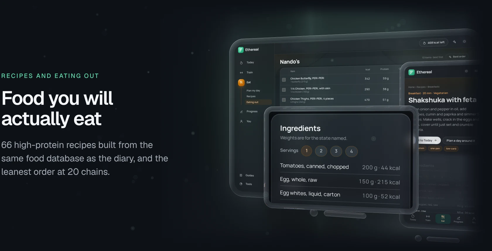</picture></a><a href="https://gallowforge.github.io/Ethereal/eating-out/#gh-light-mode-only"><picture><source media="(max-width: 767px)" srcset="docs/readme/food-light-phone.webp 2.835x"><source srcset="docs/readme/food-light.webp 2x">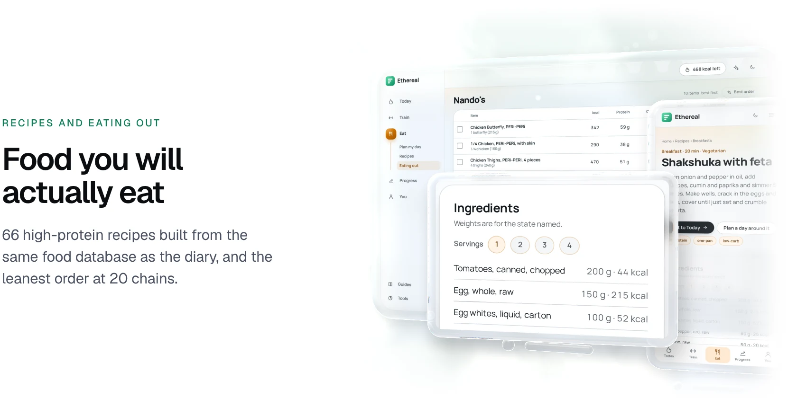</picture></a>

- **66 high-protein recipes,** each built from the same food database as the diary, so what you cook is exactly what gets logged.
- **The leanest order at 20 chains.** 155 menu items ranked by protein per calorie. Enter the calories you have left and **Best order** picks the highest-protein meal that fits.
- **A day planner that hits your numbers.** It picks four recipes, at the portions that land on your calories and protein. Swap or lock any slot, then log the lot.

## Why it is different

|                  | Ethereal               | Typical apps                    |
| ---------------- | ---------------------- | ------------------------------- |
| Price            | Free, no premium tier  | Subscription for the good parts |
| Account          | None                   | Required                        |
| Your data        | Stays on your device   | On their servers                |
| Ads and trackers | None                   | Common                          |
| Calorie target   | Adapts every two weeks | Set once                        |
| Training         | Included, progresses   | A separate app                  |
| The maths        | Open and documented    | Hidden                          |

The full comparison with MyFitnessPal, Lose It! and MacroFactor is on the [compare page](https://gallowforge.github.io/Ethereal/compare/).

## Quickstart

**Use it.** Open [gallowforge.github.io/Ethereal](https://gallowforge.github.io/Ethereal/) and install it: in Safari on iPhone and iPad, **Share**, then **Add to Home Screen**; in Chrome on Android, **Install app** in the menu; in Chrome or Edge on a computer, the install icon in the address bar. It opens in its own window like a native app and works offline. Already tracking elsewhere? Settings imports your history from MyFitnessPal, Lose It!, Cronometer or any CSV.

**Run it.** Node 20 or newer:

```bash
git clone https://github.com/gallowforge/Ethereal.git && cd Ethereal
npm install
npm run dev        # http://localhost:4321
```

**Check it.** The same checks CI runs:

```bash
npm run verify                    # data validators, type check, unit tests, build
npx playwright install chromium   # once, for the end-to-end suite
npm run test:e2e                  # Playwright on desktop and phone
```

Every push to `main` deploys to GitHub Pages. The build works at the domain root or under a sub-path; set `SITE_URL`, and `BASE_PATH` when not at the root, for canonical links and social cards (see `.env.example`). It also deploys as-is to Cloudflare Pages, Netlify or Vercel.

## How it works

Every formula lives in [`src/lib/calc`](src/lib/calc) as a pure function with tests beside it, and the [methodology page](https://gallowforge.github.io/Ethereal/about/) explains each one with its evidence. Eighteen guides in the app cover the rest in plain words, from reading the scale and managing hunger to plateaus and maintenance after weight loss.

| Question             | Method                                                                                                                                 |
| -------------------- | -------------------------------------------------------------------------------------------------------------------------------------- |
| Maintenance calories | Mifflin-St Jeor by default; Harris-Benedict, or Katch-McArdle from body fat. Activity multipliers 1.2 to 1.9.                          |
| Daily target         | Deficit capped at 25% of TDEE (550 kcal always allowed); floors of 1,200 kcal (female) and 1,500 kcal (male).                          |
| Goal date            | A week-by-week projection that recomputes maintenance as you get lighter.                                                              |
| Trend weight         | Exponential moving average of daily weigh-ins, with a 14-day slope.                                                                    |
| Two-week check       | Trend rate against the planned rate in a toward-goal frame; at most ±250 kcal, never below the floors, 14-day cooldown.                |
| Measured expenditure | Average intake plus the energy implied by the trend change (7,700 kcal per kg), with a confidence grade.                               |
| Protein              | 1.6 to 2.2 g per kg of body weight, or per kg of lean mass when body fat is known, spread across meals.                                |
| Body fat             | U.S. Navy circumference method.                                                                                                        |
| Training             | Two alternating full-body sessions; double progression up exercise ladders; week one at two sets; equipment and knee-friendly filters. |
| Exercise demos       | A jointed side-view figure posed by angles or by two-bone inverse kinematics, eased between key poses and framed to its motion.        |
| Prayer times         | Solar declination and equation of time (the PrayTimes method) with eleven authorities' conventions and a high-latitude fallback.       |
| Insights             | Weekend drift, low-protein meal, fibre, snacks, late eating, eating window, repeat foods, takeaway share. Each needs enough data.      |

<details>
<summary><b>The loop, as a diagram</b></summary>
<br>

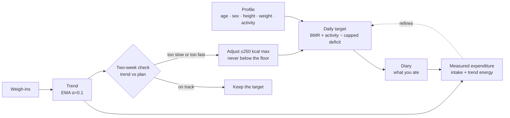

</details>

<details>
<summary><b>Privacy, by construction</b></summary>
<br>

Ethereal is static HTML and JavaScript: no server code, no database, no cookies and no third-party scripts. Page views are counted anonymously with [GoatCounter](https://www.goatcounter.com): the page address, the referring site and the screen size, never anything you enter, and never with Do Not Track, Global Privacy Control or the switch in Settings turned off. The only other network call, and an optional one, is to Open Food Facts when you scan a barcode or search packaged products.

Your plan, diary, weigh-ins, training, profile and preferences live in `localStorage`, and progress photos in IndexedDB. Settings exports, imports and deletes all of it. Shared plan links carry the plan in the URL fragment, which never reaches a server. Prayer times are calculated on the device; a shared location is rounded to about a kilometre and kept only there.

</details>

<details>
<summary><b>Stack and architecture</b></summary>
<br>

[Astro](https://astro.build) static output, [Preact](https://preactjs.com) islands, [Tailwind CSS v4](https://tailwindcss.com), strict TypeScript, Vitest, Playwright and Lighthouse CI. Manrope is self-hosted, so no font request leaves the site.

```
src/
  lib/calc/        the calculation engine: energy, macros, protein, timeline, trend,
                   expenditure, insights, streaks, chains (with tests)
  lib/train/       figure engine (inverse kinematics), 41 exercises, program builder,
                   session sequencing, audio and wake lock (with tests)
  lib/             stores, profile, life profile, day planner, prayer times, plan,
                   diary, food search, recipes, meal planner, importer
  data/            1,474 foods in six lazy chunks, and the recipes
  components/      Preact islands (today, train, you, diary, plan, review, calculators)
                   and Astro UI
  pages/           every route
  content/         18 guides
tests/e2e/         Playwright suites
scripts/           data validators and social cards
docs/readme/src/   the README's Glass scenes: captures, layouts and the renderer
```

</details>

<details>
<summary><b>Keyboard shortcuts</b></summary>
<br>

| Key             | Does                                        |
| --------------- | ------------------------------------------- |
| `⌘K` / `Ctrl+K` | Quick launcher: pages, tools, guides, foods |
| `a`             | Add food (on Today)                         |
| `w`             | Log a glass of water                        |
| `e`             | Log exercise                                |
| `⇧←` / `⇧→`     | Previous or next day                        |

</details>

## Quality

[](https://github.com/gallowforge/Ethereal/actions/workflows/ci.yml) [](LICENSE)

| Check                 | What it covers                                                                                                                                                                         |
| --------------------- | -------------------------------------------------------------------------------------------------------------------------------------------------------------------------------------- |
| 229 unit tests        | Every calculation, the trend and adjustment engine, insights, CSV import, the planners, food search, the exercise figures, training progression, prayer times and the day plan.        |
| 168 end-to-end tests  | Desktop and phone: first run, Today's plan, a workout from setup to diary, diary, planner, review, import, eating out, the tab bar, and an axe sweep of the pages against WCAG 2.1 AA. |
| Lighthouse CI         | Performance budgets on a simulated slow phone; key pages score 100.                                                                                                                    |
| Data validators       | Every food and recipe checked for shape, plausibility and energy consistency on each build.                                                                                            |
| Type check and format | `astro check` in strict mode and Prettier across the tree.                                                                                                                             |

The images in this README are real screens of the live app with a made-up demo diary (Sara), captured fresh in the dark theme and the light one and set in glass by a small WebGL renderer: `npm run readme:visuals` rebuilds every one ([`docs/readme/src`](docs/readme/src)). The exercise demo in the workout player is the app's own animation, stepped through one rep frame by frame.

## FAQ

<details>
<summary><b>Is it really free?</b></summary>
<br>
Yes. There is no account, paywall or premium tier. It is a static site, which costs almost nothing to host.
</details>

<details>
<summary><b>Where does my data go?</b></summary>
<br>
Nowhere. It is saved in your own browser. Clearing site data removes it, so export a backup from Settings first.
</details>

<details>
<summary><b>How accurate are the numbers?</b></summary>
<br>
They use the equations recommended in clinical nutrition, which carry about ±10% error for any one person. That is exactly why the two-week check exists: it corrects your plan from your real results.
</details>

<details>
<summary><b>Can I use it to gain or maintain weight?</b></summary>
<br>
Yes. The plan, trend and two-week check all work toward whichever goal you set.
</details>

## Contributing

Issues and pull requests are welcome: run `npm run verify` first, and cite a source, such as a manufacturer label or USDA FoodData Central, for any food data correction.

## Licence

[MIT](LICENSE). Ethereal provides general educational information and estimates. It is not medical advice.
